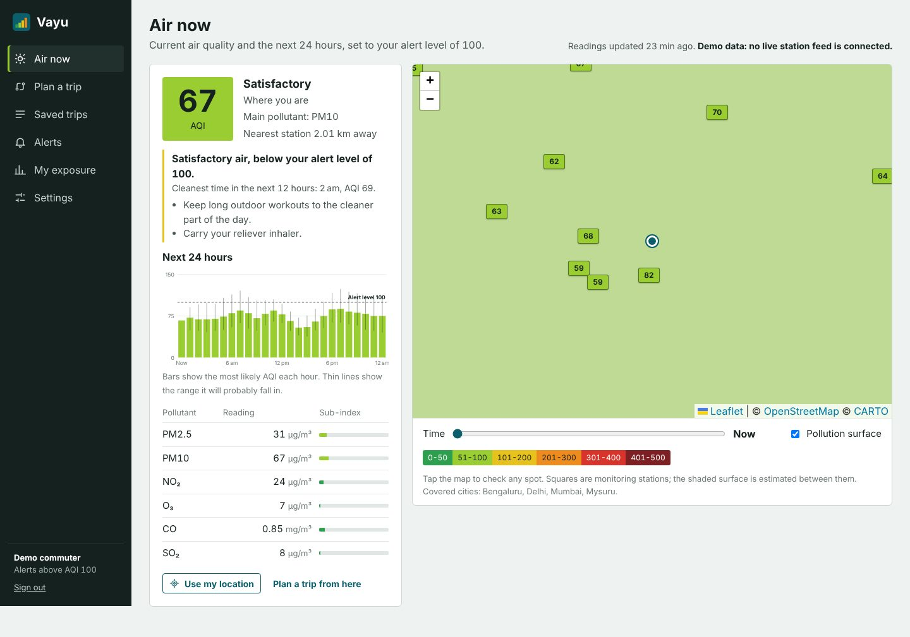
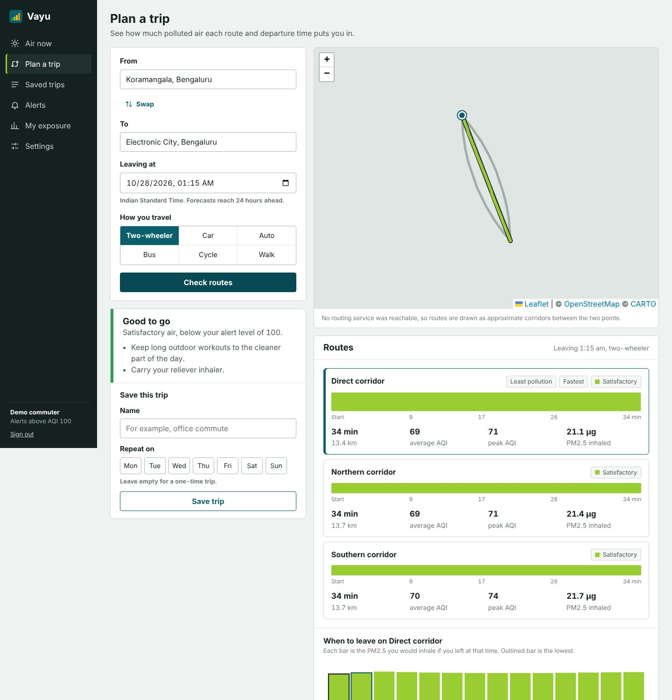
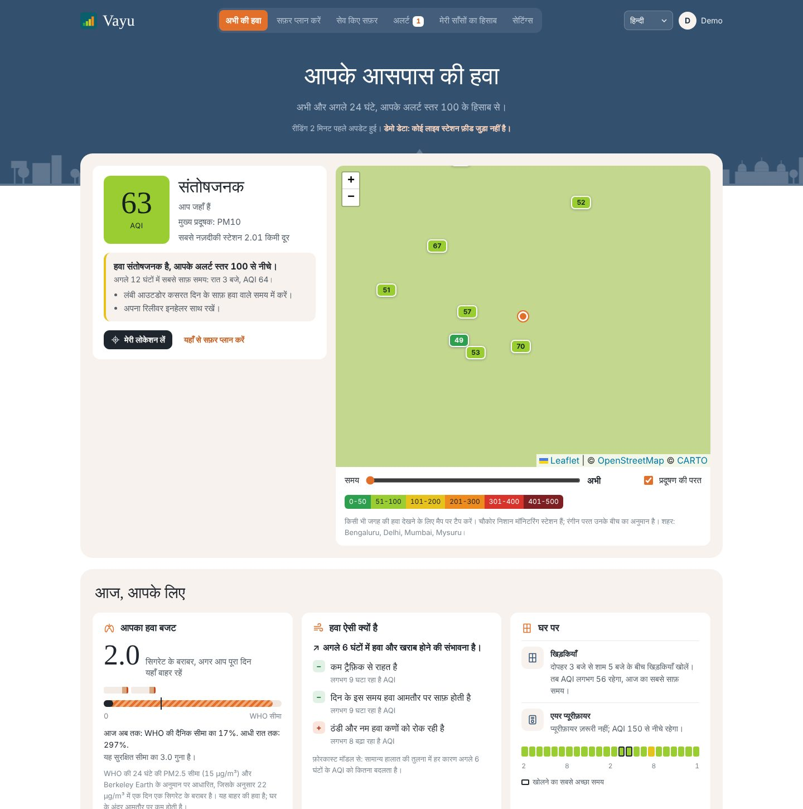
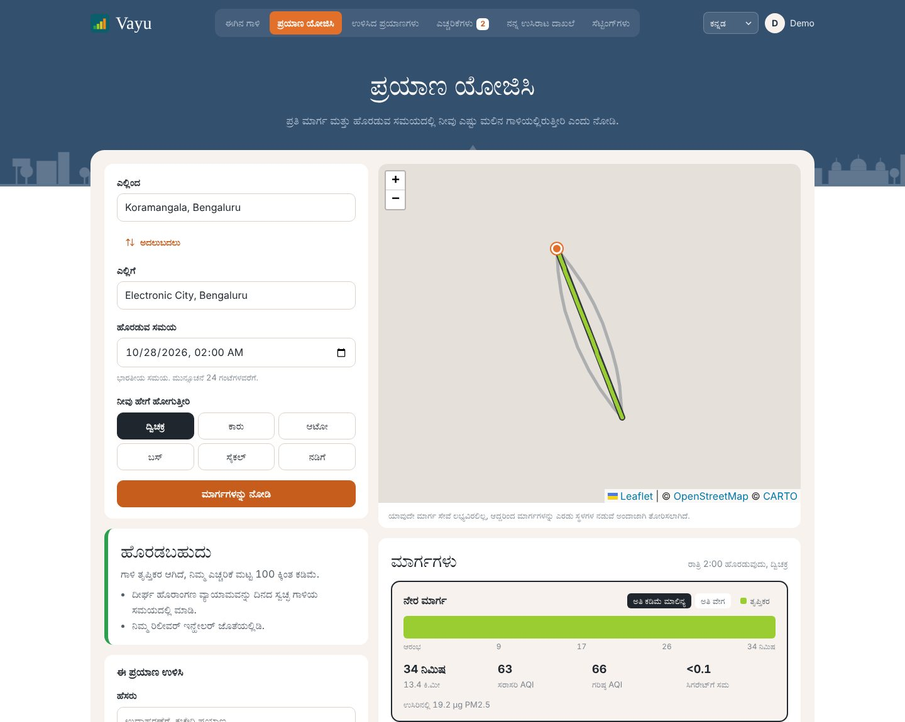
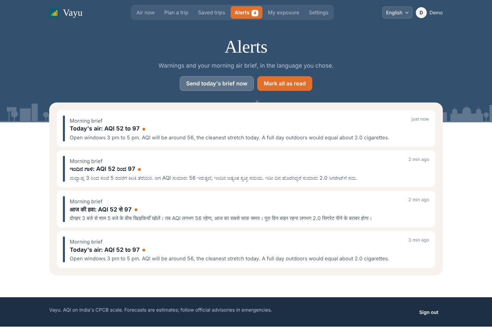
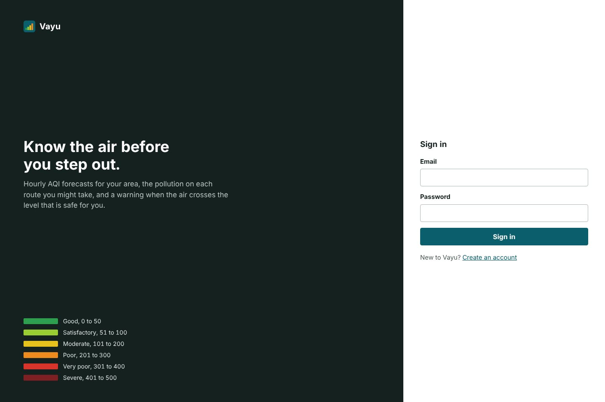
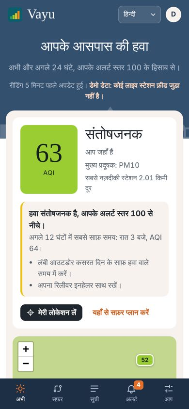

# Vayu

Air quality forecasting with personal health alerts and pollution-aware route planning, for Indian cities.

Vayu predicts the Air Quality Index (India's CPCB scale) for the next 24 hours at any point in a covered city,
works out how much polluted air you would breathe on each route and at each departure time, and alerts you
when the air where you are, or on a trip you have saved, crosses the level that is safe for your health.

**Live app: [vayu-aqi.onrender.com](https://vayu-aqi.onrender.com)**. Create a free account to try it. On the free
hosting plan the first visit after a quiet spell can take up to a minute to wake the server.

Infosys internship project by **Prachi Yadav** ([@PrachiYadav-16](https://github.com/PrachiYadav-16)).



## What it does

| Module | What is built |
|---|---|
| 1. Location and AQI data integration | Browser geolocation with an explicit consent switch, ingestion from Open-Meteo (Copernicus CAMS air quality and weather, no key needed) by default, plus optional OpenAQ v3, WAQI, OpenWeatherMap and TomTom clients, fusion into one hourly record per station, health profiles, and a time-series store with SQL and InfluxDB backends |
| 2. Forecasting model | 2-layer GRU trained with quantile loss for 1 to 24 hour forecasts with 80% intervals, ordinary kriging and IDW for estimates between stations, route exposure estimator, FastAPI prediction service, weekly retraining that only promotes a better model |
| 3. Route advisory, dashboard, notifications | Trip planner with route alternatives and a departure-time scan, Firebase Cloud Messaging push, React PWA with a Leaflet map, forecast charts and route overlays, exposure history, notification preferences and quiet hours |
| 4. Integration, testing, docs | 50 automated tests, Locust load test, Docker image, GitHub Actions CI, architecture, API, model evaluation and deployment docs |

## How the problem is solved

The brief asks for route-specific AQI forecasts and proactive alerts. A few decisions make the answer
more useful than a plain AQI map:

* **Indian AQI, not US AQI.** Sub-indices use the CPCB 2014 breakpoints and the six CPCB categories
  (Good to Severe) with their official colours, because that is the scale people in India see on the news
  and on CPCB displays. WAQI values, which are US-EPA indices, are converted back to concentrations first.
* **Forecasts with honest uncertainty.** The model predicts the 10th, 50th and 90th percentile for every
  hour, and kriging adds its own spatial variance on top. The app shows the likely range, and says so
  plainly when a point is more than 45 km from any station.
* **Exposure, not just AQI.** A trip is scored by estimated PM2.5 inhaled: forecast concentration at the
  minute you pass each 200 m stretch, times the breathing rate for how you travel, times how much road air
  gets inside (a car with windows up lets in about half; a two-wheeler rider gets all of it). That is why
  the same route can be fine by car and a bad idea by cycle.
* **Two ways to reduce exposure.** Vayu compares up to three route alternatives and also scans departure
  times from 1 hour earlier to 3 hours later. It only suggests a change when it cuts the dose by 12% or more,
  so advice stays rare enough to be worth reading.
* **Thresholds set by health.** Asthma, COPD and heart disease alert above AQI 100; pregnancy, children,
  people over 65 and outdoor workers above 150; everyone else above 200. The strictest applies, and users can
  set their own.
* **Privacy by default.** Location is only collected after the user turns it on, is thinned to one point per
  10 minutes, is deleted after 30 days, and is wiped immediately if consent is withdrawn.
* **Pollution in cigarettes.** Inhaled PM2.5 is converted to a cigarette equivalent (Berkeley Earth: a day
  at 22 µg/m³ is about one cigarette) and tracked against a daily budget set by the WHO 24-hour guideline
  (15 µg/m³). "Today equals 3 cigarettes" lands in a way "AQI 160" does not.
* **The model explains itself.** For the station nearest to you, Vayu switches off one group of model inputs
  at a time (traffic, wind, weather, time of day, season, city-wide pollution, recent trend) and measures
  how much the next 6 hours of forecast move. The top factors appear as plain sentences such as "Calm wind
  is letting pollution build up, adds about 18 AQI".
* **Advice for the home.** The cleanest two-hour stretch of the day becomes "open windows 3 pm to 5 pm", the
  worst three hours become "run the purifier 9 pm to 12 am", and both arrive in a morning air brief.
* **Your language.** The interface, every alert, the morning brief, trip suggestions and model explanations
  are available in English, Hindi and Kannada. The choice is stored on the account, so push notifications
  arrive in the same language.
* **Works without keys.** With no API keys, a simulator generates realistic station data (traffic peaks,
  winter build-up, monsoon washout, Delhi's crop-burning season) and routes fall back to OSRM or approximate
  corridors. Add keys and the same pipeline switches to live data.

## Screens

| Plan a trip | Hindi | Kannada |
|---|---|---|
|  |  |  |

| Alerts and morning brief | Sign in | Phone |
|---|---|---|
|  |  |  |

Map tiles are missing in these captures because they were taken on a machine without internet access.

## Tech stack

* **Backend:** Python 3.11+, FastAPI, SQLAlchemy 2 (SQLite by default, Postgres supported), InfluxDB 2 (optional), APScheduler, firebase-admin
* **Model:** PyTorch for training, NumPy for serving (the API does not need torch installed)
* **Frontend:** React 18, TypeScript, Vite, Leaflet, hand-built SVG charts, service worker for offline use and push, typed translation dictionaries (a missing Hindi or Kannada string fails the build)
* **Ops:** Docker, docker compose, GitHub Actions, Locust

## Run it locally

You need Python 3.11 or newer and Node 20.

```bash
# 1. Backend
cd backend
python -m venv .venv
source .venv/bin/activate          # Windows: .venv\Scripts\activate
pip install -r requirements.txt
cp .env.example .env               # optional, every key in it is optional
python -m scripts.seed             # stations, 30 days of readings, demo account
uvicorn app.main:app --reload      # http://localhost:8000/docs for the API

# 2. Frontend (second terminal)
cd frontend
npm install
npm run dev                        # http://localhost:5173
```

Sign in with the demo account `demo@vayu.local` / `vayu-demo-2026` (asthma profile, a saved weekday
commute in Bengaluru and two weeks of location history), or create your own.

### Deploy (free, 24x7)

On an Oracle Cloud Always Free Ubuntu VM:

```bash
curl -fsSL https://raw.githubusercontent.com/PrachiYadav-16/vayu-aqi/main/deploy/oracle/setup.sh | bash
```

Full walkthrough: [docs/deploy-oracle.md](docs/deploy-oracle.md).

### With Docker

```bash
docker compose up --build          # http://localhost:8000
```

### Retrain the model

```bash
cd backend
pip install -r requirements-train.txt
python -m training.train_forecaster --source sim --report          # on simulated history
python -m training.train_forecaster --source db --days 365 --report # on stored live readings
```

The server also retrains every Monday at 02:00 IST and only swaps in the new model when its validation
error is no worse than the current one.

### Tests

```bash
cd backend
pip install -r requirements-dev.txt
pytest -q
locust -f locustfile.py --host http://localhost:8000 --headless -u 30 -r 10 -t 1m
```

## Model results

On held-out data from the simulated feed (Jan to Oct 2026, never seen in training):

| Horizon | GRU MAE | Persistence MAE | Category accuracy | 80% interval coverage |
|---|---|---|---|---|
| +1 h | 7.6 | 10.8 | 89% | 81% |
| +6 h | 11.3 | 22.9 | 83% | 78% |
| +24 h | 14.2 | 16.9 | 79% | 74% |

Full report: [docs/model-report.md](docs/model-report.md). Errors are in AQI points and will be higher on
real data; rerun the report after training on live readings.

## Documentation

* [Architecture and data flow](docs/architecture.md)
* [API reference](docs/api.md)
* [Model evaluation](docs/model-report.md)
* [Testing and load test results](docs/testing.md)
* [Deploy free on Oracle Cloud (one command)](docs/deploy-oracle.md)
* [Other deployment options](docs/deployment.md)

## Known limitations

* The bundled data is simulated. Real station coverage in India is uneven; outside the four seeded cities
  the app reports that it has no nearby station rather than guessing.
* Forecasts do not yet use a weather forecast as input, only recent observed weather. Adding the
  OpenWeatherMap hourly forecast as a future covariate is the most direct way to improve +12 h to +24 h.
* The inhaled dose is an estimate built from published average breathing rates and in-vehicle infiltration
  ratios. It is good for comparing options, not as a medical measurement.
* Background push needs a Firebase project. Without it, alerts show in the Alerts list and as notifications
  while the app is open.
* Hourly AQI is computed from hourly concentrations. CPCB's official index uses 24-hour (PM, NO2, SO2) and
  8-hour (O3, CO) averages, so values here react faster than the official bulletin.

## Future scope

Weather forecast inputs, satellite aerosol data for areas without stations, smart purifier
integration (switch on automatically from the forecast), more languages (Tamil, Telugu, Marathi) and
voice alerts for people who do not read.

## License

MIT
