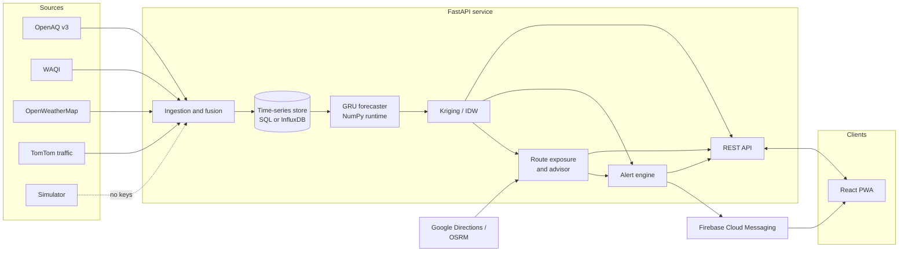
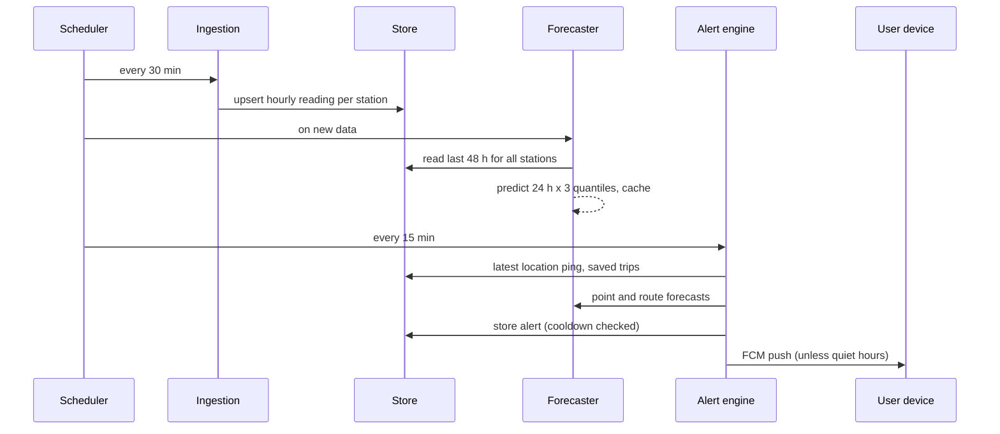
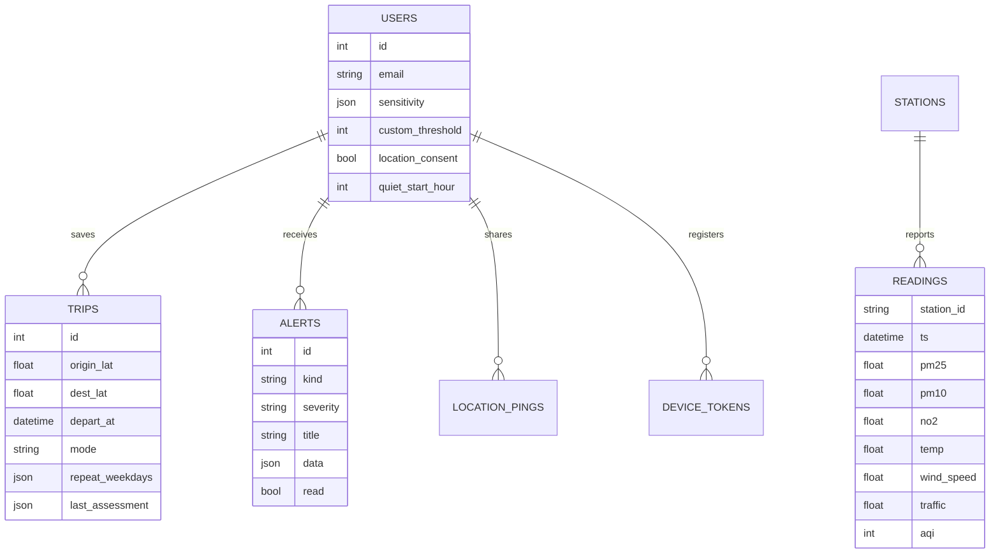

# Architecture

## Overview

The backend is one FastAPI process with a background scheduler. It can be split later (ingestion worker,
API, alert worker) because each part talks to the others only through the database and the forecast cache.

## Data flow

## Components

### Ingestion (`app/ingest`)

* `sources.py` has one client per provider. Each returns `None` on a missing key or any failure, so one
  provider going down does not stop the run.
* `pipeline.py` fuses pollutants (OpenAQ first, WAQI second), weather (one OpenWeatherMap call per ~10 km
  grid cell) and traffic congestion (`1 - current speed / free-flow speed`) into one row per station per
  hour, then computes the AQI.
* `simulator.py` produces the same rows when no pollutant source is configured. It is seeded and continuous
  from 2024-01-01, so training history and live readings are one consistent series.

### Storage (`app/store`)

`SeriesStore` has two implementations behind one interface: `SqlSeriesStore` (the `readings` table, upsert
on `(station_id, ts)`) and `InfluxSeriesStore` (measurement `reading`, tag `station_id`). Users, trips,
alerts and devices always live in the SQL database.

### AQI engine (`app/aqi`)

* `naqi.py`: CPCB breakpoints for PM2.5, PM10, NO2, O3, CO, SO2; linear interpolation within bands; the
  overall AQI is the highest sub-index and requires a PM reading, as CPCB specifies.
* `health.py`: thresholds per sensitivity group and the advice text.

### Forecasting (`app/forecast`, `training/`)

* Features (20 per hour): AQI and pollutant levels (log scale), temperature, humidity, wind as u/v
  components, traffic, hour/day-of-week/day-of-year as sine and cosine, city mean AQI, AQI change.
* Model: 2-layer GRU (64 units) over the last 48 hours, MLP head with 24 x 3 outputs. It predicts the change
  from the current AQI, trained with pinball loss at the 0.1, 0.5 and 0.9 quantiles.
* Serving: weights are exported to `.npz` and run by `gru_numpy.py`. A unit test checks it matches PyTorch
  to 1e-3.
* `spatial.py`: each query point only sees stations within 45 km. With 6 or more stations it fits an
  exponential variogram and solves ordinary kriging, otherwise IDW (power 2). Kriging standard deviation
  widens the forecast interval.
* Retraining: `--promote-if-better` keeps the current model unless the new one's validation MAE is within
  2% or better.

### Routing (`app/routing`)

* `providers.py`: Google Directions (with traffic) then OSRM (FOSSGIS car, bike and foot profiles) then an
  offline approximation. Each travel mode has a breathing rate and an infiltration factor.
* `exposure.py`: samples the route every 200 m, runs one spatial estimate for all samples and all 24 hours,
  then any departure time is evaluated by shifting forecast hours. Three routes x 17 departure times costs
  one interpolation per route.
* `advisor.py`: picks the cleanest route, scans departures from -60 to +180 min in 15 min steps, and adds a
  suggestion only when it saves 12% or more.

### Alerts (`app/notify`)

* Location rule: latest ping within 2 hours, current or next-3-hour AQI above the user's threshold.
* Trip rule: a saved trip departs within 3 hours (repeating trips resolve to the next matching weekday),
  and the best option still crosses the threshold or a better route or time exists.
* Cooldown 3 hours per place, 1 per trip per day. Quiet hours skip the push but keep the alert.
* FCM tokens that come back unregistered are deleted.

### Frontend (`frontend/`)

React + TypeScript + Vite. Pages: Air now, Plan a trip, Saved trips, Alerts, My exposure, Settings.
Leaflet draws station markers, the interpolated surface (a canvas image from `/api/air/grid`) and routes
coloured segment by segment. Charts are plain SVG. The service worker caches the app shell and the last
air data so the app opens offline, and displays FCM pushes.

## Database schema

